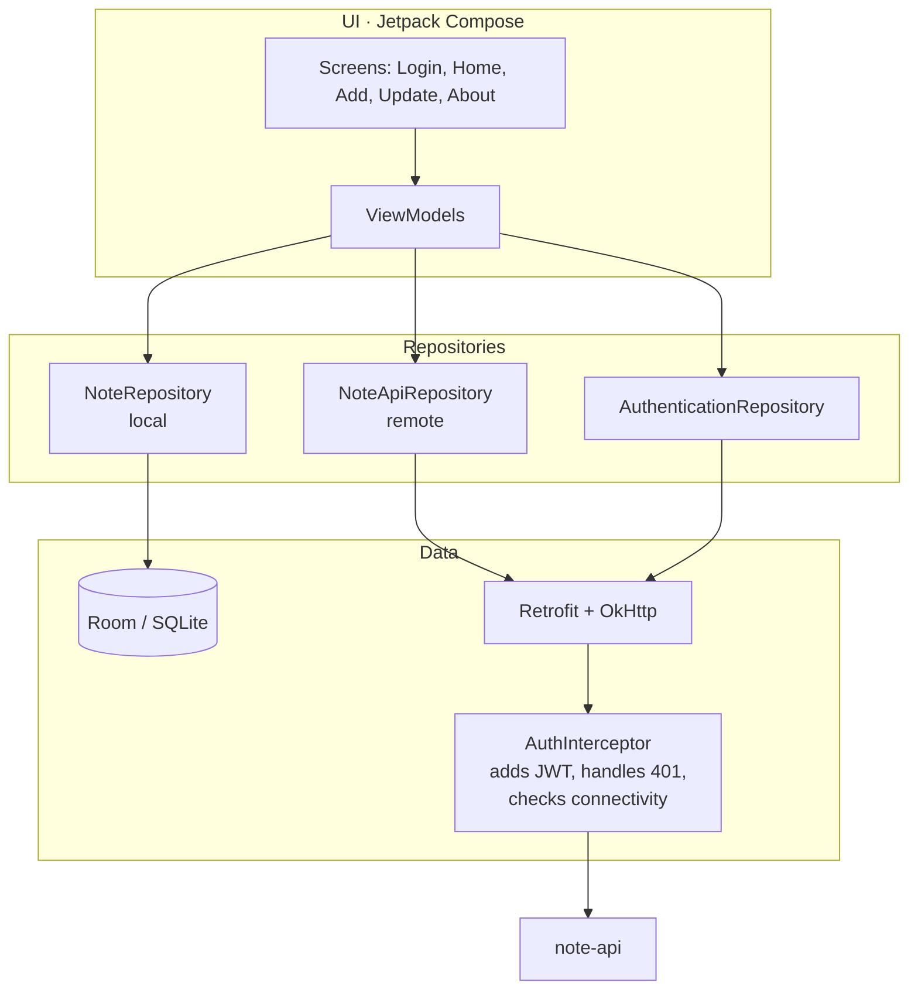
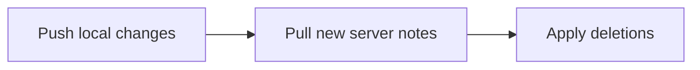

# note-app (KhatNevesht)

Offline-first Android note-taking app in Kotlin with Jetpack Compose. Notes are stored in a local Room database, so the app works without a connection, and they sync with [note-api](https://github.com/Babakkamali/note-api), the Go backend, when you're online. You sign in with your phone number and an SMS code.

I built it as a university project in September 2023.

## Architecture

The app follows MVVM. Compose screens observe ViewModel state, and ViewModels go through repositories to reach Room or the API.

The UI always reads notes from Room as a `Flow`. That keeps it usable offline and refreshes the screen whenever the data changes.

A single OkHttp interceptor handles the network concerns. It adds the `Bearer` token to note requests, throws a `NoConnectivityException` when the device is offline, and on a `401` clears the token and broadcasts a logout.

The API base URL is a `BuildConfig` field read from `local.properties`: `STAGING_URL` for debug builds and `PRODUCTION_URL` for release builds.

## How sync works

Each local note has its own ID plus the `serverId` it has on the backend. A deleted note stays in Room as a tombstone (`isDeleted = 1`) until the server delete has gone through.

1. Push: notes with `serverId = 0` are created on the server and store the ID they get back. When a note exists on both sides, the copy with the newer `updatedAt` overwrites the other.
2. Pull: server notes that the device doesn't have, and hasn't deleted, are inserted locally.
3. Delete: tombstoned notes are deleted on the server and then removed locally. Notes the server no longer has are removed from the device.

Sync runs when the home screen opens and after every delete.

## Running it

1. Open the project in Android Studio (compile SDK 33, min SDK 27).
2. Copy `local.properties.example` to `local.properties` and set `STAGING_URL` / `PRODUCTION_URL` to your note-api address.
3. Start [note-api](https://github.com/Babakkamali/note-api) with Docker Compose, then run the app.

## What I'd do differently today

- Run sync in WorkManager with retries and network constraints, so it no longer depends on a screen being open.
- Last-write-wins trusts device clocks and can silently drop an edit. Versions or timestamps assigned by the server would be safer.
- The JWT is kept in plain SharedPreferences. EncryptedSharedPreferences, or DataStore backed by the Keystore, would protect it.
- Room is opened with `allowMainThreadQueries()`. All database work should run on background dispatchers.
- Add Hilt for dependency injection and unit tests for the sync logic, which is the riskiest part of the app.
